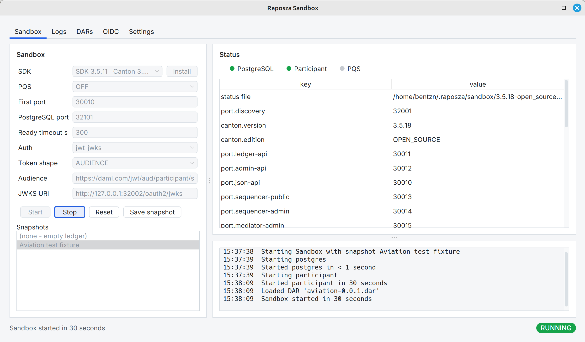
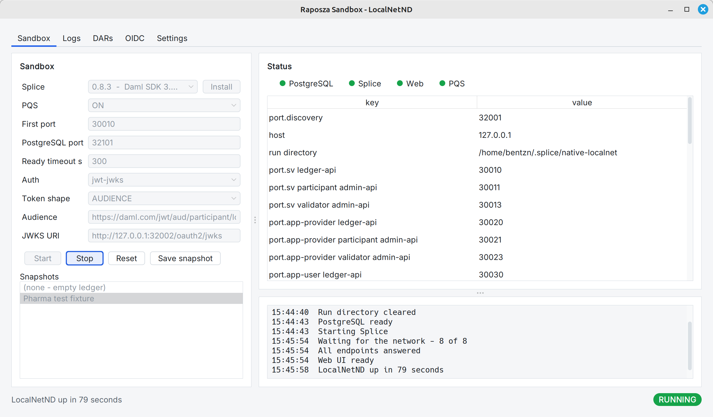
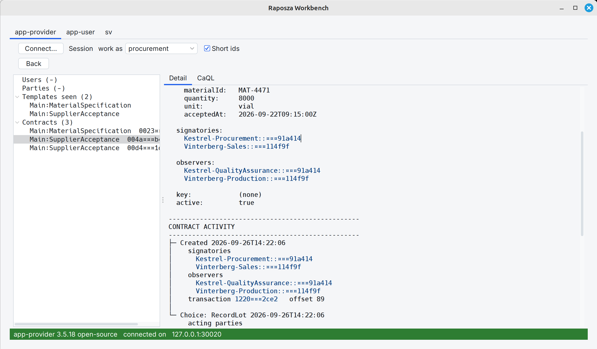
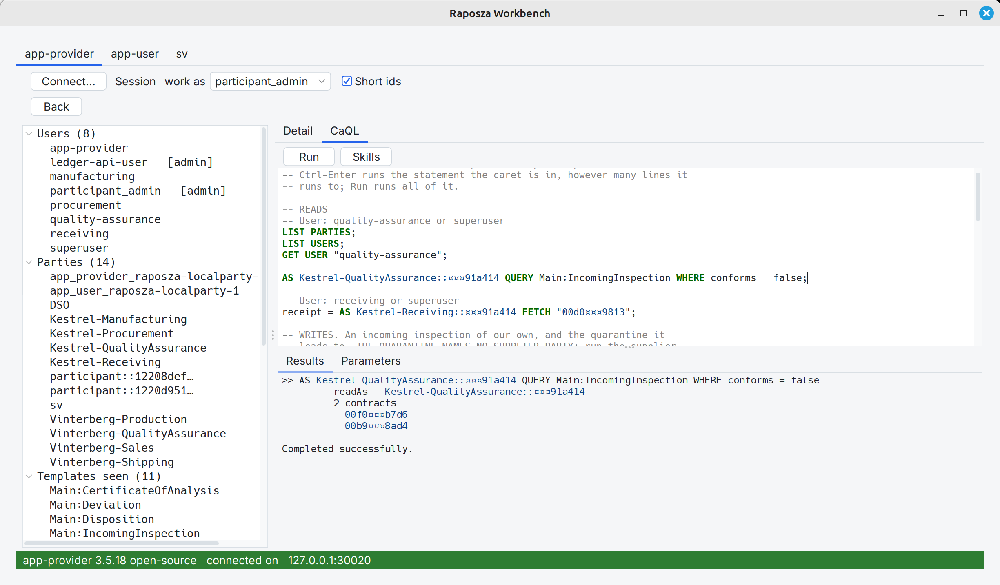
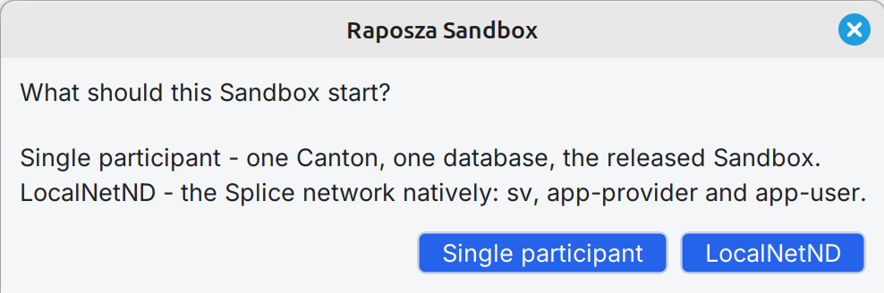
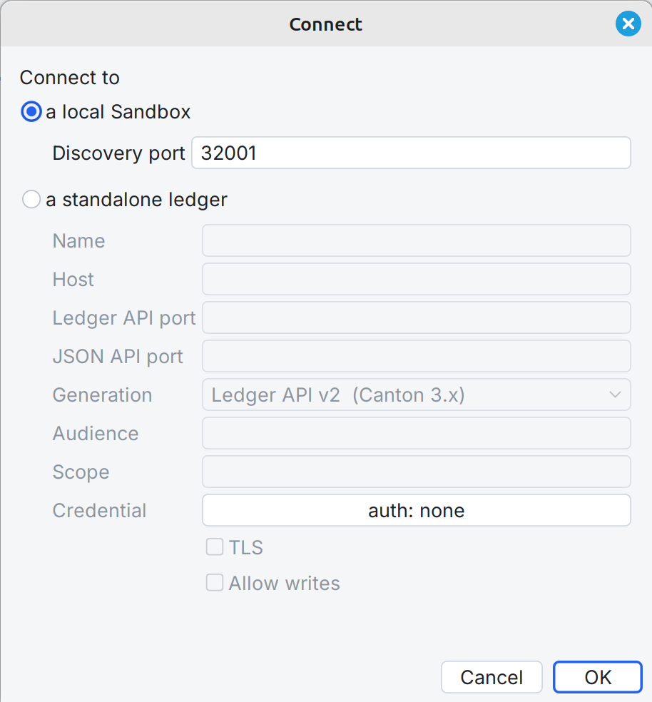
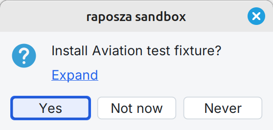
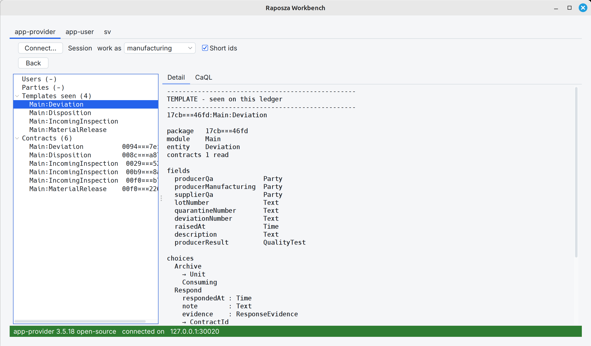
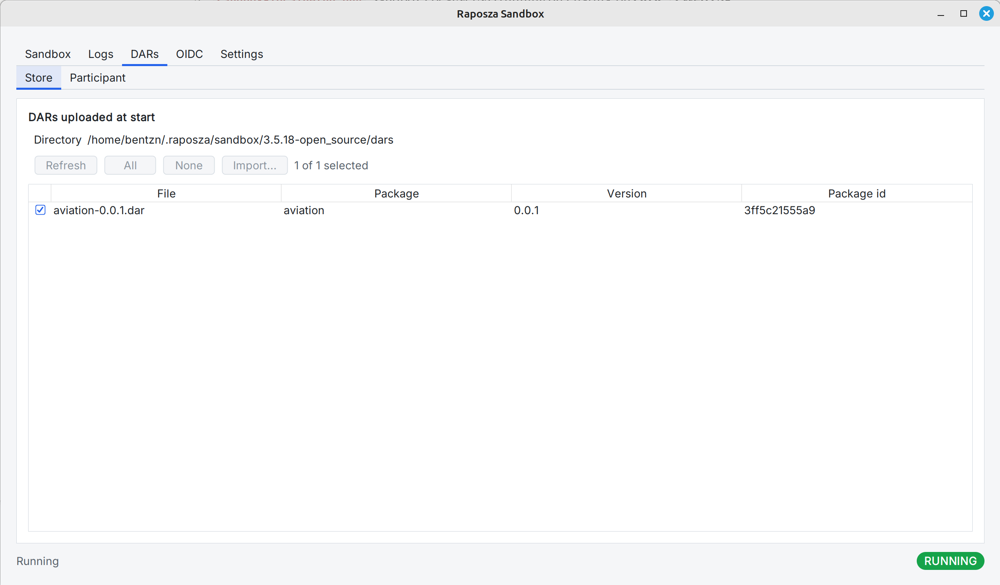
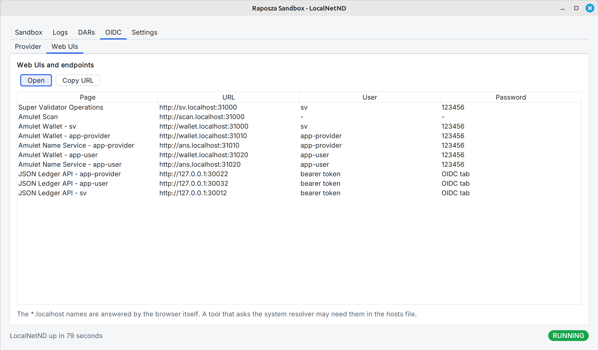

<!-- Copyright (c) 2026 bentzn -->
<!-- SPDX-License-Identifier: Apache-2.0 -->
<!-- Author Claude/bentzn  Generated 2026-10-12T07:03:15Z -->
# Raposza Tools

**A complete Canton and Splice development environment on your own machine. No Docker. No containers. One window.**

Press **Start** and you get a running ledger with real data on it. Then look inside it: parties, packages, templates, contracts and their history. You don't write a line of setup code.



---

## Sandbox — a ledger, one click away

* **Single participant** — a Canton participant and its PostgreSQL, started as ordinary processes.
* **LocalNetND** — a complete Splice LocalNet, with `sv`, `app-provider` and `app-user`, running natively. LocalNet, No Docker.
* **Data from the first start** — the Aviation fixture on a single participant, and the Pharma fixture across two organizations on LocalNetND.
* **Snapshots** — every start begins from a clean, known ledger. Save the state you want and return to it whenever you like.
* **DARs under control** — upload, remove, vet and unvet, per participant.
* **Authentication included** — Raposza OIDC, a local OpenID Provider, so authenticated ledgers and the Splice web UIs work from the start.
* **Many Canton versions side by side** — the 2.x and 3.x lines. DPM, SDKs and Splice releases install from the window.



---

## Workbench — see what is really on the ledger

* Connects to a running Sandbox with no configuration, one tab per participant.
* Reads the Daml-LF from the participant itself, so templates and contracts show their real field names and types. No codegen.
* Shows a contract together with its activity.
* Also connects to a standalone ledger, read-only unless you allow writes.



---

## CaQL — the ledger in a few lines

CaQL is Raposza's declarative ledger language. It allocates parties, creates contracts, exercises choices and queries with `WHERE`. You get repeatable fixtures, demos and experiments without writing a Daml Script or an application.

```
trainee = ALLOCATE PARTY "Trainee";

AS <maintenance control> QUERY Main:Defect WHERE grounded = true;
```



---

## Why Raposza

* **No containers.** Built for machines where Docker is unavailable, inconvenient or prohibited.
* **Linux and Windows.** One Java 21 runtime, two application jars.
* **Every organization's view.** Two organizations on two participants, each in its own tab, so you see exactly what each of them sees.
* **Supported means tested.** Every capability is stated against the Canton versions it was run on.
* **Open source.** Apache-2.0. Canton and Splice come from Digital Asset; Raposza does not redistribute them.

---

## More screenshots

| Sandbox | Workbench |
| --- | --- |
| [](docs/images/sandbox-topology.png)<br>Choose what to start | [](docs/images/workbench-connect.png)<br>Connect to a local Sandbox |
| [](docs/images/sandbox-fixture-prompt.png)<br>Test data offered at start | [](docs/images/workbench-template-detail.png)<br>A template as the ledger holds it |
| [](docs/images/sandbox-dars.png)<br>DAR management | |
| [](docs/images/sandbox-oidc-web-uis.png)<br>The Splice web UIs, signed in | |

---

## Get started

* [FIRST_INSTALL.md](FIRST_INSTALL.md) — from a clean machine to a running Sandbox and Workbench, on Linux and Windows.
* [BUILD_AND_INSTALL.md](BUILD_AND_INSTALL.md) — building from source.
* [README_LONG_TIME.md](README_LONG_TIME.md) — architecture, tested versions and known limitations.
* [SECURITY.md](SECURITY.md) — read this before running the Sandbox on a shared machine.

## License

Apache License 2.0 — see [LICENSE](LICENSE).
